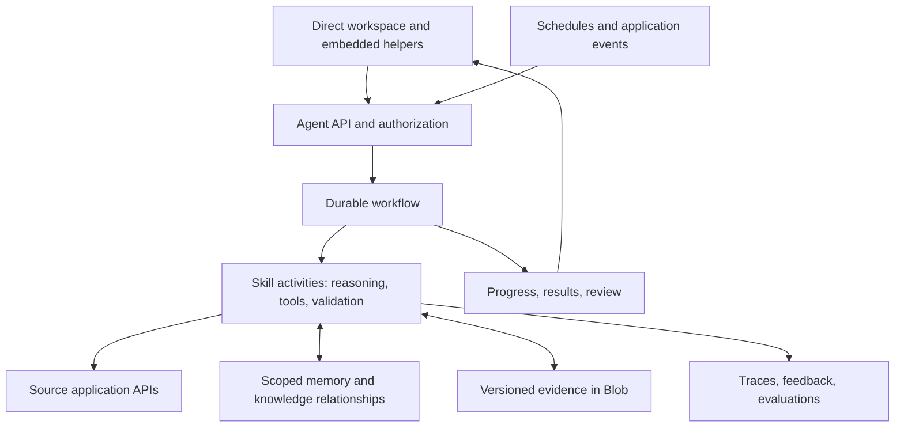

# AlamoAgent Living Build Spec

- purpose: consolidate AlamoAgent product decisions, implementation evidence, target architecture, acceptance criteria, and the next build work
- status: living build spec; current capabilities and proposed work explicitly separated
- owners: Eric Wilson (product decisions), Platform engineering (implementation and verification)
- updated: 2026-10-16
- tags: alamoagent, workflows, skills, memory, knowledge, embedding, evaluations
- labels: platform-handbook, living-spec, build-plan
- related files:
  - [Integration strategy and current agent boundary](integration-platform.md#alamoagent-first-application-spanning-slice--2026-10-16)
  - [Current product surfaces](product-surfaces.md#licensing-reports)
  - [Architecture](architecture.md)
  - [Deployment receipts](deployment-operations.md#alamoagent-name--2026-10-16)
  - [LIC 624 and Executive Director workflows](executive-director-workspace.md)
  - [Approved visual identity](material-folder-design.md#alamoagent-assistant-mark)
  - [Analyst runtime](analyst-system.md)
  - [Quality gates](testing-quality.md)

## 1. Authority and maintenance

This is the canonical build spec for AlamoAgent. Keep this file current as the
product is discussed and built; do not leave decisions solely in chat or create
a separate dated plan for each iteration. The latest explicit user instruction
takes precedence over this document.

At each relevant handoff:

1. Record new or changed requirements and superseded decisions.
2. Reconcile the capability matrix with source and test evidence.
3. Mark deployment only when a release receipt verifies it; distinguish saved,
   implemented, locally verified, and deployed work.
4. Update the next deliverable, remaining questions, and acceptance evidence.
5. Update the owning current-state docs if actual behavior changed.
6. Record the date and a concise decision/change entry below.

This maintenance happens alongside authorized AlamoAgent work. It does not
create a scheduled job, authorize a release, expand user access, or enable
notifications. Link release details from operations rather than copying image
digests into multiple competing records.

Status vocabulary:

- **Required:** an explicit product requirement or operating restriction.
- **Implemented:** present in source; deployment is a separate claim.
- **Deployed:** supported by a dated operations receipt.
- **Proposed:** the recommended build direction, still requiring implementation.
- **Deferred:** intentionally outside the active rollout or slice.
- **Open:** an unresolved decision or acceptance detail.

The architecture choices below capture the recommendation discussed with Eric.
Documenting them is not evidence that infrastructure has been provisioned.

## 2. Product contract and fixed restrictions

| ID | Requirement | Current decision |
|---|---|---|
| P01 | One general helper with application skills | AlamoAgent; Licensing is one skill. Earlier EveryAgent and OneAgent naming is superseded. Internal legacy API/file identifiers can remain stable. |
| P02 | Work first | Standing responsibilities and application events create useful work. Conversation directs, explains, or corrects that work; the user should not have to write a prompt for every routine check. |
| P03 | Quiet embedded experience | Small green original Alamo head/tree orb, immediate work and source access, drill-down, and optional conversation. No welcome hero, greeting, product heading, subtitle, tagline, or first-visit pop-up. Keep functional report titles and labels. |
| P04 | Preserve familiar UX | Reuse the existing report editor, material styling, and dormant chat where appropriate. Do not replace them with a new product-launch interface. |
| P05 | Private rollout | Agent navigation, UI, APIs, and workers remain Eric-only. Platform admin status is not an implicit agent grant. |
| P06 | Notification restriction | No emails yet. Earlier intended recipients Raj and Betty are retained as future product context, not active delivery authorization. |
| P07 | Andrew's identity | Wilson with the supplied red face logo is saved for later. Branding is presentation only; Andrew has no agent access or worker assignment enabled. |
| P08 | Cross-application ambition | The same agent should work through connected applications. Each app retains its runtime, transactions, rules, and authorization. |
| P09 | Learn within scope | Personal preferences, source-backed company knowledge, task continuity, and tested procedural improvements are distinct. |
| P10 | Traceable licensing work | Readable summaries and report text, preserved source links/originals, honest extraction/freshness states, and drill-down into evidence. |
| P11 | Native LIC 624 plus backlog intake | New forms can start in-app; uploads remain useful for backlog. Preserve the existing editor and validate fidelity to the official form. |
| P12 | Demonstrable quality | Reliability and useful outcomes are measured through acceptance tests and evals. “Perfect” is an objective, not a readiness claim. |
| P13 | Pipeline assessment review | Supervisors can ask AlamoAgent for team assessment-workflow exceptions; assessors can ask about their own assigned work. Show evidence and the next review action, without treating sparse records as proof of poor performance. |
| P14 | Independent agent home with cross-app conversations | Work with AlamoAgent directly in its own workspace; let a conversation use authorized application capabilities as needed and continue from embedded entry points. The independent API, standalone home and central summary conversations are implemented locally; live hosting/identity setup and full report/correction workflows remain pending. |

Raj and Betty retain standalone Licensing permissions. The previous request for
a Jarvis-like introduction was superseded by the later explicit removal of all
introductory copy. The original combined Alamo logo is the selected one; the
more prominent color variant was superseded.

## 3. Baseline and evidence

Baseline reconciled on 2026-10-16 against this checkout and the existing dated
deployment receipts. Production was not re-probed while creating this spec.

| Capability | Status | Evidence and practical limit |
|---|---|---|
| Private embedded helper and agent workspace | Deployed | [Product surfaces](product-surfaces.md#licensing-reports), [rename release](deployment-operations.md#alamoagent-name--2026-10-16). Workspace, compact companion, sources, scope, pause/resume, review receipts, history. |
| Licensing and Admissions watch skills | Deployed | [Catalog](../../shared/everyagent-catalog.mjs), [adapters](../../server/everyagent-adapters.mjs). Pipeline supplies protected aggregate summaries only. |
| Assessment review for supervisors and assessors | Required; not implemented or deployed | The present aggregate Admissions watch has no user-scoped assessment-detail contract. A Pipeline-owned read projection and role-tested agent grant are needed before either role can use it. |
| Personal monitoring state | Deployed | [Service](../../server/everyagent-service.mjs), [persistence](../../server/everyagent-persistence.mjs). ETag-protected Blob, source fingerprints, lease, assignments and work history. |
| Durable monitoring workflow | Implemented and locally verified; not deployed | [Functions registration](../../server/everyagent-functions.mjs), [versioned orchestrator](../../server/everyagent-orchestrator.mjs), [workflow service](../../server/everyagent-workflow-service.mjs). Real Functions host restart/replay tested with isolated Azurite. General model planning and durable model-turn replay remain future work; summary conversations are implemented separately below. |
| Dormant owner chat | Implemented, separate surface | [OwnerChatPage](../../src/features/home/pages/OwnerChatPage.tsx) reuses the existing conversational analyst workspace. The agent companion currently links to Ask a question; conversation is not integrated into its tasks. |
| Independent monitoring API and worker | Implemented; local verification recorded below; not deployed | [HTTP host](../../server/everyagent-host.mjs), [worker](../../server/everyagent-worker.mjs), [package builder](../../scripts/prepare-everyagent-package.mjs). Both runtime packages exclude Platform source implementations. The independent API revalidates source access before showing persisted work. |
| Authenticated Platform source connector | Implemented; not deployed | [Source API](../../server/platform-agent-source-api.mjs), [source grants](../../server/platform-agent-source-grants.mjs), [HTTP client](../../server/everyagent-source-client.mjs). Workload identity plus a source-owned, expiring, revocable subject/skill/community grant; Licensing summaries and existing Admissions aggregates only. |
| Direct workspace and portable conversation | Implemented locally; not deployed | [Shared home](../../src/features/agent/conversations/AgentConversationHome.tsx), [conversation service](../../server/everyagent-conversations.mjs). Central Blob-backed summary conversations, explicit skill/resource scope, task-linked entry, read-time authorization and registered-client continuity. Full report analysis, correction/learning workflows and live model/Entra verification are still pending. |
| Native LIC 624 creation and editing | Deployed | [Native reports](executive-director-workspace.md#native-reports), October 13 release. Create, save, reopen, review, and versioned audit are present. The earlier upload-only limitation is obsolete. |
| Upload and extraction | Implemented; see owning workflow for release evidence | Fillable-PDF extraction and review exist. Image-only files stop at OCR-required; connected OCR, automatic filing, incident linking, and official-PDF generation are not delivered by native creation. |
| Readable state-report reader | Deployed | [Licensing Reports](product-surfaces.md#licensing-reports). Briefs, paragraphs, page references, findings/corrections, and original download. |
| Andrew's Wilson branding | Implemented and verified; deferred rollout | [Brand resolver](../../shared/agent-branding.mjs), [saved identity](material-folder-design.md#andrews-saved-wilson-mark). Source commit 79efed7; not deployed by the branding request. |
| Company knowledge store | Local prototype | [Integration knowledge boundary](integration-platform.md#company-knowledge-and-workflow-boundary). Immutable documents, proposed assertions, review and search contracts; not durable production memory. |
| General graph, editable personal memory, skill authoring, learning loop | Proposed | Evidence references attached to work are not yet a shared knowledge graph or an automated improvement system. |
| Email and broader rollout | Deferred | Email delivery remains disabled; no send action in the current agent command contract. |

Current implementation specifics:

- React 19, TypeScript 5, Vite 8, Tailwind/custom CSS, MSAL/Entra.
- Node ESM API modules with checked contracts, hosted with the browser bundle in
  Azure Container Apps. Vercel adapters are retained but do not describe the
  current public production host.
- Existing Claude synthesis follows deterministic analyst tools. Read-only
  production configuration on October 16 confirms claude-sonnet-4-6. The
  monitoring workflows and independent work API do not call a model.
- Databricks/published snapshots own governed analytics; Blob holds documents,
  source captures, and current agent state.
- The web worker wakes every minute; due assignments check published sources
  every 15 minutes under a two-minute lease. State collection has its own
  Monday/Wednesday cadence. These clocks must not be conflated.
- Current state has bounded history and capacity. It is an intentional first
  slice, not the target storage architecture for all workflow executions.

## 4. Target stack and system boundaries

| Layer | Proposed choice | Keep, extend, or add |
|---|---|---|
| Agent workspace and embedded UI | React/TypeScript direct workspace plus shared companion components | Extract existing chat/module components; share conversation/task APIs across authorized hosts |
| Agent API | Independently deployed Node/TypeScript service on Azure Container Apps with its own Entra API audience | Monitoring/conversation API implemented; cloud registration, hosting and live verification remain pending |
| Application tools | Versioned adapters calling source-owned authenticated APIs | Keep domain rules, record authorization, and transactions in each application |
| Durable orchestration | Azure Durable Functions, checked JavaScript ESM, Azure Storage backend | First worker implemented and verified locally; separate cloud deployment pending |
| Reasoning | Existing Claude integration behind typed model/tool contracts | Reuse initially; version model selection per skill and compare changes through evals |
| Skills | Versioned TypeScript capability packages with input/output schemas | Extend the current catalog into executable, tested contracts |
| Operational records | Azure PostgreSQL | Add transactional task projections, assignments, evidence metadata, memory, and relationship records |
| Retrieval | PostgreSQL full-text search plus pgvector when semantic retrieval is needed | Add scope-filtered, rebuildable indexes |
| Source bytes | Azure Blob | Retain immutable originals and derived artifact versions |
| App integration | Authenticated APIs and versioned events with stable identifiers | Extend per source application; source owns its transactions |
| Observability and quality | Structured traces, Azure Monitor/Application Insights, existing test scripts and task eval datasets | Add durable trace/outcome records with redacted/minimized payloads |

The orchestration backend owns execution checkpoints and replay history.
Postgres owns application-facing task metadata, authorization references,
memory, evidence relationships, and query projections. Define versioned events
and idempotent projection updates; do not create two competing execution state
machines or assume cross-service writes are atomic.

The model runtime operates inside workflow activities. Deterministic
orchestrator code does not make live model or external API calls during replay.
No agent SDK alone is assumed to provide the durable business workflow.

The first runtime slice deliberately retains assignments, review receipts, and
work projections in the existing ETag-protected Blob. Durable Functions owns
execution history and checkpoints. Moving those application projections to
Postgres is a separate migration, not a prerequisite for proving orchestration.
No existing Pipeline or Workforce database is repurposed for Platform state.

Azure Durable Functions currently supports TypeScript. The separate standalone
Durable Task JavaScript/TypeScript SDK is documented as preview; the proposed
production foundation uses the supported Functions integration. Recheck service
availability and package compatibility when implementing.
[Microsoft workflow documentation](https://learn.microsoft.com/en-us/azure/container-apps/workflows-overview)

Azure PostgreSQL supports pgvector for similarity search; similarity does not
establish truth or authorization.
[Microsoft pgvector documentation](https://learn.microsoft.com/en-us/azure/postgresql/extensions/how-to-use-pgvector)

Do not move Pipeline referral transactions or AlamoHealth clinical code into
Platform. A connector or host is complete only when its real contract, access
checks, failure behavior, and tests exist. A logo, app link, or catalog entry is
not an integration. Additional frameworks, message brokers, graph databases,
or model providers need a concrete requirement and evidence of benefit.

## 5. Workflow and execution contract

Every run records a task ID, tenant and owner, assignment or initiating event,
permitted application/community/record scope, workflow and skill versions,
input references, success conditions, timestamps, budgets, and outcome.

Proposed task lifecycle: queued, running, waiting for review or input, completed,
failed, or canceled. Retries are attempts within a task. A paused standing
assignment stops new scheduled work; cancellation governs an individual run.
Specify the race behavior before introducing external writes.

Required execution behavior:

- Durable timers, waits, bounded retries/backoff, cancellation, and recovery
  after deployment or worker loss.
- Stable event IDs and deduplication. Side-effecting tool calls carry operation
  keys honored by the destination, or reconcile ambiguous results before retry.
- Check authorization on each tool action, after waits, and before publication.
  Bind execution to the relevant assignment version; scope changes invalidate
  pending work that no longer qualifies.
- Persist tool/model outcomes and evidence references. Pin workflow, skill,
  prompt, and model configuration versions for an in-flight run.
- Enforce step, time, token, and cost bounds; fail or request needed input
  rather than loop indefinitely.
- Treat fetched documents and app text as evidence, never authority to change
  instructions, access, destinations, or permitted actions.
- Any future review gate records the exact proposed action and resource
  version; changed payloads or stale approvals require revalidation.
- Preserve unavailable, stale, ambiguous, and verified-zero states separately.

First complete workflow: licensing change review.

1. Resolve an authorized assignment and check the published source or invoke
   an explicitly allowed collection activity.
2. Capture the original and its URL, content hash, retrieval time, publication
   date, and report/inspection dates when present.
3. Extract readable text with page/section provenance; retain the raw original.
4. Compare versions and distinguish new reports from changed content.
5. Produce a structured brief with findings, source-supported dates,
   correction details, and clearly labeled unknowns.
6. Validate identity, scope, citations, schemas, and factual support.
7. Publish one work item per relevant change and expose the supporting original.
8. Attach questions, corrections, and review receipts to that task.

This workflow does not infer that an old correction deadline is currently
overdue. It does not send email under the current restriction.

## 6. Cross-app embedding and authorization

A proposed host context includes application ID, current route, selected
community/record references, filters, and the active task or conversation.
The server verifies each supplied reference; host context expresses intent
and never grants permission. Do not ingest arbitrary page content by default.

Effective access is the intersection of user permissions, source-app
permissions, assignment scope, skill actions, and any narrower task scope.

- The same helper can appear in multiple apps without giving those apps shared
  database access or copying their runtime code.
- Each adapter owns a bounded API/tool contract, source authentication,
  stable record IDs, freshness rules, size limits, and error mapping.
- Background jobs use explicit server-side grants and managed credentials;
  they do not store a browser access token as permanent authority.
- Revalidate grants after revocation and after long waits. Apply access filters
  before retrieval reaches the model, including graph traversal and embeddings.
- Carry explicit task/record references across hosts. Do not automatically
  merge all application transcripts or private memories into one context.
- Personal branding remains separate from grants. Wilson cannot activate
  Andrew's access. Source-app access does not itself activate the agent.
- New hosts preserve keyboard/focus behavior, responsive layout, and the
  user's task context. The current Pipeline skill is not proof of a Pipeline
  embedded host.

The companion should show actual work, progress, and evidence with optional
conversation. Reuse the dormant chat's working components after tracing their
dependencies; do not mount a second competing state or polling system.

### Independent service and direct workspace

AlamoAgent should have one independently deployed service and a direct web
workspace. `agent.alamoplatform.com` is a proposed address, not a provisioned or
verified endpoint. That workspace opens existing conversations, work, sources,
and responsibilities with the same quiet helper styling. It does not require
an open Platform, Pipeline, or Workforce tab to run a task.

Keep the code in an independent `alamoagent` application/repository, optionally
as a sibling under the workspace wrapper. It owns its build, dependencies,
Entra API registration, deployment, and operational data. The wrapper remains
documentation-only. Until repository extraction is implemented, this file remains the
canonical spec; move it with the service and leave a pointer when ownership
actually changes, rather than maintaining two competing build specs.

| Boundary | Agent owns | Application owns |
|---|---|---|
| Experience | Direct workspace, shared conversation/work components, progress and citations | Compact entry point and verified navigation/context bridge |
| Execution | Conversation/task IDs, orchestration, skill selection, budgets, task outcomes | Domain operations, validation and transaction rules |
| Identity | Agent access grant, conversation membership, assignment and tool policy | Current user roles, team membership and record/resource permissions |
| Data | Scoped conversation/task metadata, authorized evidence references, personal memory and improvement records | Authoritative records, original documents, application audit and data lifecycle |
| Connectivity | Versioned capability registry and adapters with bounded output contracts | Authenticated API endpoints and authorized, deduplicable events |

Deploy the web/API service separately from the durable Functions worker. They
share agent-owned contracts and application-state storage; the workflow engine
continues to own replay history. PostgreSQL is the target for conversations,
assignments, task projections and scoped memory; Blob retains appropriate
artifacts. The first extraction can retain the current Blob projection adapter
until the separately tested data migration. Do not copy source application
databases into the agent or move the existing Platform knowledge prototype
wholesale into a general memory store.

Extraction status, established from source and local checks:

- `shared/everyagent-identity.mjs` now owns the Eric-only agent rollout grant.
  The skill catalog independently applies Licensing access to that skill.
  This separation does not enable another user or broaden source permissions.
- `shared/everyagent-client.mjs` injects the authenticated transport and endpoint.
  Platform uses it with its existing auth helper and compatibility route.
  The independent host serves `/api/agent/v1/work`; routing the production UI
  there requires its own Entra registration/token acquisition and cutover.
- The pure adapters accept injected source readers. Platform composition lives
  in `server/everyagent-platform-adapters.mjs`, used by the legacy facade and
  legacy inline worker. The independent durable worker now calls the Platform
  source API over authenticated HTTP. Both independent packages exclude source
  readers and the Platform reporting runtime. Background source grants are
  implemented; interactive OBO, new source applications, and general user/team
  delegation remain future contracts.
- A fixed application link registry now resolves Platform-relative evidence
  into verified absolute links for the independent API. Connector evidence
  carries application, resource kind/ID and source revision. The existing
  Platform interface retains its local navigation behavior. The direct-home
  candidate reuses these links; production chat navigation remains configuration-gated.
- The API package contains 33 runtime files, its separate browser bundle and
  three direct dependencies; the
  worker has 21 runtime files and four direct dependencies. Both use minimal
  locks derived from the reviewed root lock. Production requires managed
  identity and connector configuration; existing state schema/path is retained
  for migration continuity. Cloud storage/identity ownership, source grants,
  repository extraction and cutover still need operational setup. Conversation state uses a separate versioned Blob collection; the existing
  monitoring schema is unchanged. No database was provisioned.

### Conversation continuity and application selection

Persist conversations centrally with tenant, owner/membership, resource scope,
messages, task links and provenance. A new conversation can start at the direct
home or inside an application. An embedded launch supplies only bounded
context references: host application, current route, selected resource IDs,
filters and an optional conversation ID. The service validates those references
and conversation membership. Page text and a conversation ID grant no access.

Opening the same conversation from another authorized host resumes its stored
task and messages. Opening a new chat does not merge prior transcripts. Keep
current page context separate from the chat's explicit scope: changing tabs
must not silently change the target of an in-flight task. Cross-app questions
can select additional read capabilities within the user's existing permissions
and the task's limits; a chat explicitly locked to an app or resource remains
locked until the user changes that scope.

For each turn, the service resolves permitted capabilities, loads the relevant
skill, calls the required source APIs, validates the returned evidence, and
responds in the same chat. Show which applications supplied information and
their freshness. An unavailable app produces a labeled partial answer, not an
inferred result. Open a source application's UI only when the user chooses a
source/action link or the workflow needs a handoff that its APIs do not support.
Record IDs from different apps require an explicit mapping before any join.

Expose versioned conversation, message, task, event-stream and capability
contracts. Mutations use request IDs; streamed events have sequence IDs for
reconnect without duplicate messages or tasks. Personalization and scoped
memory remain central so switching hosts does not create a separate agent.
Source-specific transcript/evidence permissions are rechecked on retrieval,
including after membership changes; conversation ownership alone does not
preserve revoked access to source data. Derived messages and artifacts carry
their required source permissions; withhold or recompute an affected answer
when its permitted portions cannot be separated reliably.

Start with a shared React client for trusted first-party apps and the direct
workspace. It receives the agent API client, bounded host context and a
navigation callback; it does not import another app's stores or runtime. Calls
to the central API use agent-targeted authentication, exact allowed origins,
and independently checked host data policy. Bind that policy to registered,
authenticated clients rather than a browser-supplied host name or CORS alone.
Do not forward transcripts into the host's server logs or analytics. A component
rendered in a host page shares
that page's JavaScript trust boundary; use an agent-owned isolated frame or a
direct-workspace handoff for any host that must not see its rendered content.

### Connector identity and transport

An application is connected when it publishes a versioned capability contract:
operation ID, input/output schema, identity mapping, allowed resource scope,
freshness/error states, evidence references, action category and idempotency
rules. Begin with existing HTTPS APIs. Add MCP wrappers when discovery or
reuse by another agent client justifies them; MCP is not required for the
first decoupled service and does not replace application authorization.

For interactive Entra-protected APIs configured to support delegation, use an
agent-targeted access token and obtain the appropriate downstream token via
On-Behalf-Of. Each app still checks its roles and resources. Other identity
systems require a verified mapping/delegation contract; do not assume shared
sign-in establishes shared authorization. Background jobs use workload identity
plus an explicit, revocable user assignment that the source can authorize;
an organization-wide service token cannot stand in for that user scope.
Tokens and secrets stay out of model context, conversations and task history.
[Microsoft's OBO contract](https://learn.microsoft.com/en-us/entra/identity-platform/v2-oauth2-on-behalf-of-flow)
requires audience-specific downstream tokens; optional MCP integration must
also honor [MCP authorization](https://modelcontextprotocol.io/specification/2025-11-25/basic/authorization).

First decoupling proof: start a chat at the direct home, request a Licensing
change summary and authorized Admissions aggregates, open a cited source, and
resume the same conversation from Platform without a duplicate task. Verify
that a wrong host, another user, a revoked source grant, an expired session,
and a broken connector cannot expose another conversation or broaden access.
The initial direct home remains Eric-only; connecting an app does not activate
its users or expand this rollout. Email remains disabled.

### Pipeline assessment review handoff — 2026-10-16

Eric wants the assessment audit he can request manually to be available through
AlamoAgent. A supervisor should be able to ask for team-level work that needs
review; an assessor should be able to ask the same questions about their own
assigned referrals and receive practical next steps. This is a new requirement,
not a claim that the current Eric-only agent or aggregate Admissions watch
already supports those users. It does not authorize email or clinical writes.

Pipeline must own a bounded, read-only assessment-review projection. The
existing Platform admissions-summary bearer token and aggregate watch are not
a user authorization mechanism for referral-level data. The new connector must
authenticate the real requesting person, map that identity to Pipeline's
current roles and assignments, and enforce scope in Pipeline before data leaves
it. Supervisors see only the team scope Pipeline grants them; assessors see
their own assigned work, including authorized reassignment/coverage changes.
Agent assignment, Platform admin status, a client-provided assessor ID, or a
background service credential cannot expand that scope. Recheck authorization
on detail reads and after reassignment or revocation. Background tasks need an
explicit per-user grant and must not reuse a browser token indefinitely.

The minimum projection for each authorized referral includes stable referral
and assessment IDs, assigned assessor ID, workflow/decision status, draft and
signature timestamps, Meet the Client send status, reason-code/note presence,
assessment revision, provenance category, and a versioned completion summary
derived from Pipeline's current question rules, including narrative-presence
counts without narrative content. Include distinct fields edited by the
assessor of record after import, last authored change, and source/audit
timestamps. Do not use raw autosave event totals as a measure of effort, or
count imported/seeded values as answers the assessor personally entered. Keep
unknown, unavailable, stale, and verified-zero states distinct. Return a
bounded page/cursor and source-as-of timestamp; never silently truncate the
team or turn a failed pull into an empty queue.

Agent summaries should flag neutral, evidence-backed review cases: a signed
assessment with little or no authored answer activity, a declined referral
without a documented reason, an active referral with no assessment, an
unsigned/in-progress assessment needing follow-up, or a decision/send status
that merits verification. Some early declines are legitimate, and an imported
record may be clinically useful; these are prompts to inspect, not misconduct
findings or automatic workflow blocks. The assessor view should explain what
is missing or imported on their own case and link to the authorized Pipeline
workspace. The supervisor view can filter by assessor and date within the
server-enforced team scope. Default agent task state, chat history, traces,
and notifications contain counts, statuses, IDs, and source links only, not
client names, clinical answers, packets, or narrative text. Any later detail
view must reauthorize at read time in Pipeline and audit the access.

First acceptance cases: (1) assessor cannot request a coworker's referral by
ID, filter, prompt, or background task; (2) supervisor can review only their
authorized team; (3) reassignment and grant revocation remove access on the
next read; (4) signed imported-only, substantive authored, declined-without-
reason, and ordinary in-progress fixtures produce distinct explanations;
(5) changed questionnaire versions use the correct rules; (6) a source
failure remains visibly unavailable and retains prior evidence without
publishing a false zero; (7) browser, API, worker, logs, and agent memory
respect the same PHI boundary. The current private pilot remains in force
until these role and data-scope checks pass and a separate release is verified.

## 7. Skills and personal responsibilities

A reusable skill definition describes how a job is performed. A personal
assignment selects which resources, triggers, preferences, and outputs apply
to a particular user. Team assignments are deferred beyond the private pilot.

Each executable skill should declare:

| Contract area | Required contents |
|---|---|
| Identity | Stable skill ID, version, owner, application/capability |
| Invocation | Supported intents, event/schedule/manual triggers, input schema |
| Scope | Required grants, eligible resources, field/data minimization rules |
| Tools | Explicit allowed operations, action categories, tool schemas |
| Procedure | Instructions, bounded planning steps, examples and recovery rules |
| Result | Output schema, artifacts, evidence/citation requirements |
| Validation | Deterministic checks, review rules, completion conditions |
| Memory | Which scoped records may be read, proposed, corrected, or persisted |
| Limits | Time, steps, tokens, cost, retry and idempotency policy |
| Quality | Fixtures, eval dataset/version, thresholds, release/rollback record |

Build a skill by choosing a real job and acceptance examples, exposing the
minimum source tools, implementing the workflow, testing failures and scope,
and then registering it. Load only permitted relevant skill instructions/tools
for the task. General user authoring can later compose approved capabilities;
new executable tools require normal code and contract review.

Candidate progression: improve Licensing change review; prove a second durable
workflow using Pipeline aggregates; later consider authorized native LIC 624
draft assistance and other app-specific work. Draft creation, edits, filing,
notifications, and clinical actions each require their own action contract and
authorized rollout; existing read skills do not confer them.

## 8. Memory, knowledge graph, and learning

| Memory kind | Examples | Scope and lifecycle |
|---|---|---|
| Task continuity | Inputs, step results, open questions, review receipts | Task and owner scope; persisted across sessions with retention rules |
| Personal preference | Summary length, preferred ordering, assigned communities | User-visible, editable/deletable; does not override app policy |
| Company knowledge | Source-backed report/finding/facility relationships | Explicit sharing scope, provenance, timestamps, validity, review state |
| Procedural improvement | A better extraction rule or skill prompt | Versioned candidate, tested before release; separate from live memory |

Notification restrictions and authorization are enforced policy/configuration,
not soft conversation memory. Normal use does not silently retrain model weights.

Start the graph with relational nodes and edges such as community → report →
finding → follow-up task → responsible person. Preserve canonical source IDs,
source document/version references, observation and applicable dates, access
scope, assertion status, and supersession/correction links. Model-extracted
assertions enter proposed state; only the explicit review path promotes them
to approved knowledge. Review of a work card is not approval of every assertion.

Search is a rebuildable projection. Source records remain authoritative.
Define stale-evidence handling, conflict resolution, expiry, deletion, and
permission revocation for both source records and derived indexes. Removing a
personal memory must stop its future retrieval; audit retention requirements
must be specified separately and visible.

Proposed improvement loop:

1. Capture observable calls, versions, evidence references, outcome, latency,
   cost, and user correction with minimal sensitive payloads.
2. Triage the correction into preference, knowledge correction, or skill defect.
3. Convert confirmed defects into reproducible eval cases; keep held-out cases.
4. Propose a changed prompt, tool, parser, routing rule, or model configuration.
5. Run deterministic checks, task evals, and human review on important samples.
6. Compare the candidate in a read-only shadow run, then a limited release.
7. Promote a version only with recorded results; retain rollback.

Do not log hidden model reasoning or let a runtime agent rewrite its own
production authorization or executable tools. Fine-tuning is a future option
only if measured failures justify it.
[Agent evaluations](https://developers.openai.com/api/docs/guides/agent-evals)
and [reviewed improvement loop](https://developers.openai.com/cookbook/examples/agents_sdk/agent_improvement_loop)
inform this proposed process.

## 9. Acceptance and evaluation gates

Every build slice includes quality work. Advanced learning may arrive later;
permission, recovery, and result checks begin with the first workflow.

| ID | Acceptance requirement | Evidence required |
|---|---|---|
| Q01 | Resume interrupted work | Kill/restart a worker between meaningful steps; same task resumes with correct prior results |
| Q02 | Deduplicate delivery and actions | Repeated event and ambiguous-response tests produce one intended result; side effects are destination-idempotent or reconciled |
| Q03 | Enforce isolation and revocation | Tenant/user/community/record denial tests; revoke during execution/wait; deny subsequent reads/actions/publication |
| Q04 | Ground claims | Representative reports with claim-to-source checks; distinguish source facts, inference, dates, unknowns, and mixed findings |
| Q05 | Preserve source truth | Missing/stale/failed/zero cases remain distinguishable and retain prior evidence |
| Q06 | Preserve user control | Pause, cancel, review, correct, retry and memory-edit flows; inspect real task progress |
| Q07 | Keep the helper usable | Phone/desktop, keyboard, focus, retained scope, readable reports, source links, no introductory launch copy |
| Q08 | Prevent instruction injection | Untrusted report/tool text cannot change grants, tools, destinations, or workflow restrictions |
| Q09 | Bound resources | Measured step, latency and cost budgets, timeouts and failure outcomes; numerical targets fixed before release |
| Q10 | Release repeatably | Versioned workflow/skill/model/config, regression results, migration checks, and rollback evidence |
| Q11 | Respect rollout restrictions | Eric-only agent; Raj/Betty standalone Licensing; Andrew inactive; no email delivery |
| Q12 | Retain form fidelity | Preserve native editor/review behavior; official-form field/content comparison and representative demo validation before claiming official output parity |
| Q13 | Scope assessment review | Assessor-own and supervisor-team permission tests, reassignment/revocation, versioned completion, imported-versus-authored evidence, missing-reason cases, PHI-minimized memory/logs, and unavailable-source behavior |
| Q14 | Decouple and resume across hosts | Direct home and Platform share a conversation/task; audience-specific auth, source revocation, host policy, scoped transcripts, reconnect/deduplication, valid cross-app links and partial-source failures are verified |

Use deterministic assertions for permissions, schemas, replay, and duplicate
prevention. Use fixed representative task datasets, semantic grading, and human
review for factual completeness and usefulness. Automated model graders do not
prove security or correctness. Include both unchanged and changed sources,
different document formats, extraction failures, wrong-community records,
permission changes, and adversarial text.

Existing checks remain the regression base: check:everyagent, check:licensing,
check:licensing-job, check:platform-knowledge, and relevant browser/form checks.
The owning app's docs, TypeScript, full analyst, and build gates remain required.
No new workflow is considered complete from a mock-only UI or a passing build.

Spec consolidation verification, 2026-10-16: documentation/link and repository
retention checks, both TypeScript checks through the full analyst gate, the
complete analyst suite, and the production build passed. This verifies the
documentation change against the existing code; it does not establish the
proposed workflow or memory capabilities. No production release was performed.

## 10. Build sequence and active deliverable

| Slice | Deliverable | Exit evidence | Status |
|---|---|---|---|
| S0 | Reconciled living spec and agent entry-point guidance | Current/planned split, requirement IDs, implementation map, linked handbook and retention registration | Implemented; maintained with this build |
| S1a | Durable task foundation exercised by a Licensing check | Scoped contracts, persisted checkpoints, restart, duplicate, cancellation and revocation tests; traceable result | Implemented and locally verified; not deployed |
| S1b | Independent agent API, connector boundary and controlled worker rollout | Extracted access/client/source contracts, isolated cloud worker/storage, cutover/rollback evidence, retained assignments/reviews; separate Postgres migration proof | Independent API/worker, authenticated Platform source connector, revocable grants and portable links implemented; hosting, Azure identity/grant setup and cutover pending |
| S2 | Direct agent workspace and complete Licensing workflow with task-linked conversation | Existing chat components reused; central conversation → scoped sources → brief → work → correction; direct-home/Platform continuity and Q14 checks | S2a direct home and scoped summary conversations implemented locally; full-report/correction workflow, durable model-turn replay and live rollout pending |
| S3 | Second durable workflow and second embedded host | Pipeline adapter permissions and aggregate boundary preserved; same task accessible from authorized hosts; no transcript leakage | Proposed |
| S3a | Pipeline assessment-review read skill | Pipeline-owned scoped projection; supervisor-team and assessor-own queries with source-backed exceptions and Q13 checks | Required; not implemented |
| S4 | User-controlled memory and knowledge relationships | Memory review/edit/delete, source-backed graph, scoped retrieval, assertion approval and correction tests | Proposed |
| S5 | Measured improvement and additional skills | Corrections become evals, candidate comparisons, version promotion/rollback, task-level cost/latency targets | Proposed |
| S6 | Broader rollout and optional notifications | Explicit rollout decision and per-user/action validation; recipients/channels confirmed at that time | Deferred |

S1a is a vertical implementation of the existing Licensing and aggregate
Admissions adapters through the real durable engine, behind a separate worker
entry point. The authenticated API and UI expose run progress, cancel, and retry.
The deployed web timer remains the production scheduler until S1b cutover.
Avoid generic unused infrastructure and preserve current state during migration.

The monitoring API, source connector and independently packaged worker establish
the extraction boundary. S2a adds the direct workspace over central
conversation contracts and registered-client transcript policy. Provision audience,
workload identities, source grant storage and hosting with concrete cost and
cutover evidence; wire the existing client to it after live verification. Add
a second host after continuity works. This extends the tested runtime rather
than reimplementing its workflows.

Migration must account for existing assignments, scope, review receipts, and
unresolved work. Plan an idempotent import from the existing Blob, compare
results, prevent both schedulers from publishing concurrently, and define how
rollback preserves writes after cutover. A database or workflow deployment by
itself is not completion.

The next concrete proof is: a Licensing task survives a restart, produces one
cited result, accepts a correction, and passes the regression case derived from
that correction. Restart, a cited result, and review persistence are verified
for S1a. Task-linked summary conversation is implemented in S2a; the correction
workflow and its learning eval remain S2.
Maintain the private pilot throughout.

### S1a implementation record — 2026-10-16

- Pinned runtime packages: durable-functions 3.6.0 and @azure/functions 4.16.5.
  A targeted uuid 11.1.1 override removes the newly introduced vulnerable
  transitive version; the production dependency audit passes.
- A timer dispatches authorized assignments to agentMonitorV1. Its collect,
  validate, publish, and failure activities use bounded retries and a 20-minute
  task deadline. Persisted task IDs survive lost dispatch responses.
- Activity outputs are projected into scoped, bounded evidence before entering
  orchestration history. Unknown upstream fields are dropped; unsafe evidence
  links, duplicate entry keys, unsupported relations, and altered validation
  digests are rejected. The existing deterministic Licensing reader supplies
  report summaries; this slice does not add model-generated findings.
- Permission and assignment-version checks run before collection, after the
  source response, during validation, and atomically with publication. Cancel
  prevents later publication and skips that scheduled occurrence; pause stops
  the responsibility. Already completed effects are not represented as undone.
  Tests also cancel during the source request and between validation and its
  commit, proving those responses do not create a new checkpoint after cancel.
- Task completion, assignment cursor, work item, and run receipt commit in the
  same ETag update. Duplicate activity delivery preserves the same receipt.
  A failed run has at most one retry successor, including a replayed command
  arriving after that successor completed.
- A persisted execution-mode fence prevents the updated web timer from claiming
  or publishing once the durable worker takes ownership. A worker heartbeat
  drives availability; the browser is not the scheduler.
- Active tasks are retained separately from 300 recent terminal tasks, with a
  hard 50-active-task limit. Work capacity and unresolved-review retention are
  unchanged. Engine-history retention/purge configuration is still required
  before cloud rollout; it is separate from these application projections.
- The new progress disclosure is functional UI, with real phases and cancel/
  retry controls. Existing work, sources, branding, and standalone Licensing
  remain intact. No new email or source-application write tool is introduced.
  Browser checks pass at 320, 390, and 1440px, including scope, pause, review,
  cancellation, retry, focus, source recovery, and overflow checks.
- The actual Functions host test kills the process during validation, restarts
  against the same isolated storage, and verifies one source read, the same
  instance, one cited result, one run receipt, and persisted review.
  Reproduce with the [workflow checks](../../scripts/check-everyagent-workflows.mjs)
  and [Functions host check](../../scripts/check-everyagent-workflow-host.mjs).
- The worker package is prepared with everyagent:prepare-worker. It has no
  public HTTP starter; the production entry requires NODE_ENV=production and
  managed-identity storage. No cloud deployment has occurred.
  Preparation rebuilds its own generated directory, excludes private
  presentation assets, and passes a production-only dependency install and
  startup checks for missing storage or an incorrect runtime mode.

S1b includes the independent monitoring API/worker and authenticated Platform
source connector. Cloud activation still requires live source grant and
identity verification, sizing/network configuration,
durable history retention, and a tested operational cutover/rollback procedure.
The direct workspace and task-linked summary conversation now have a local
implementation. Add the correction path and explicit memory review next;
introduce Postgres with import and reconciliation checks as conversation volume
and scoped memory grow beyond the bounded pilot.
The full application gate and production build pass; the [local verification
receipt](deployment-operations.md#alamoagent-durable-worker-candidate--2026-10-16-not-deployed)
records the host and browser evidence separately from production releases.

### S1b initial API extraction record — 2026-10-16

- The shared work handler powers both the existing Platform URL and a separate
  Node HTTP host. The latter owns no timer, source reader, email sender or model
  client. It reads and updates the existing ETag-protected work projection.
- Standalone authentication verifies RS256 Entra v2 tokens for the configured
  tenant, its own audience, a delegated scope and explicit client IDs, then
  applies the Eric-only agent grant. No Platform development bypass is copied.
  Browser origins are exact HTTPS allowlist entries; CORS is not authorization.
  Per-host data policy remains pending before any additional host is enabled.
- The real HTTP test signs synthetic tokens and checks wrong audience, issuer,
  tenant, client, scope, signature, expiry, application-only claims and denied
  users. It also checks missing auth, CORS, 4 KiB command limits, redacted failures,
  optimistic conflicts, review persistence through host recreation, and shared
  cancel/retry behavior. The same suite passes from the isolated API package.
- Production startup refuses missing auth/storage configuration and development
  mode. The real CLI also starts, serves health/auth denial, and shuts down
  cleanly with synthetic configuration. The package includes only its explicit
  runtime closure, a pruned lock and Dockerfile. No resource, DNS record, client registration or repository
  was created. A Docker image build and cloud identity/ingress test remain
  release prerequisites; an npm package check is not a deployed-service check.
- Documentation, both TypeScript checks, the complete analyst suite, production
  build, browser checks at 320/390/1440px and the real worker process-restart
  check pass. The isolated dependency tree matches the existing reviewed root
  lock without version or integrity drift.
- See the [API verification and operations receipt](deployment-operations.md#alamoagent-independent-api-candidate--2026-10-16-not-deployed).

### S1b source connector and worker extraction — 2026-10-16

- Platform exposes a versioned, workload-only source API with `read` and
  `authorize` operations. It accepts a dedicated Entra v2 audience and the
  application role `AlamoAgent.Source.Read`, then checks the token's client and
  service-principal IDs against a source-owned grant. Browser tokens, a supplied
  user ID, generic admin roles and agent API tokens cannot establish permission.
- Each grant binds the workload to one subject, skill, permitted communities,
  expiry and revocation state. The source's existing Licensing/owner policy and
  Eric-only rollout are additional constraints. The uncached registry lives in
  a separate private container; neither agent workload nor state identities may
  write it. Missing, ambiguous, malformed, expired or revoked grants fail closed.
- Source authorization runs before and after source I/O. The connector returns
  only bounded work evidence; Pipeline's organization summary remains a
  Platform-owned aggregate projection. Referral rows, patient data, raw report
  payloads and unknown fields do not cross this boundary. This is not the future
  assessor/supervisor review capability or direct Pipeline user delegation.
- The durable worker carries a source grant revision in its result and rechecks
  it after collection, at validation and before publication, including replay.
  These are point-in-time distributed checks, not a cross-service transaction:
  revocation may occur immediately after the last check. Subsequent retrieval
  independently verifies current access and hides results when authorization
  fails or cannot be reached. Existing work remains retained under its storage
  policy; hiding an item does not erase already-read data or engine history.
- Review, retry and resume/scope changes require source authorization in the
  independent API. Pause and cancel remain available while a source is down or
  access has been withdrawn. Assignment revisions are checked after permission
  I/O so a concurrent scope change cannot return the earlier scoped snapshot.
- Source links resolve through a fixed application registry, with typed resource
  references and revisions. No host-supplied destination, redirect, arbitrary
  URL, transcript or credential selects a tool or expands scope. The HTTP client
  rejects redirects, enforces a deadline and response bound, and sanitizes errors.
- Both independent runtimes now use the HTTP connector. The Platform compatibility
  facade keeps its direct source composition and existing inline timer until
  controlled deployment. The later S2a candidate adds conversation, trusted-client
  transcript policy and direct UI. OBO, additional host policies, repository
  separation and live Entra/Azure verification are still unfinished.
- Deterministic signed-token HTTP checks cover wrong audience/identity/scope,
  revoked/expired/changed grants, revocation during a read, denial at publication
  and retrieval, response bounds, injected links, secret exclusion, and retained
  reviews. Reproduce with `check:everyagent-source`.
- `check:everyagent-connector-host` installs the worker package outside the repo,
  runs the actual Functions host against a separately authenticated local source,
  and kills/restarts it between collection and validation. Its receipt and the
  complete regression results are recorded in [operations](deployment-operations.md#alamoagent-authenticated-source-connector--2026-10-16-not-deployed).
- Local verification passed: the full analyst gate, documentation checks, both
  TypeScript checks, production build, isolated API/worker checks and browser
  checks at 320/390/1440px. Platform's own transport keeps portable Platform
  evidence links local; independent clients retain absolute application links.
  These results establish local readiness only, not live connector access.

### S2a direct home and scoped conversations — 2026-10-16

Implemented locally; not deployed or enabled for another user:

- `src/agent-main.tsx` and `agent.html` build an independent browser bundle.
  The API can serve it from a fixed directory; only its root, emitted assets
  and approved logo are public. The bundle excludes Platform's router/runtime
  and private assets. Platform optionally mounts the same conversation component
  at `/analytics/agent?chat=<id>` using the central agent API.
- The home opens work first, with a compact mark, saved chats and a New chat
  control. It reuses the dormant chat's compact composer and formatted-message
  component. No launch copy, introductory hero or greeting is added. Discuss
  opens a chat limited to the work item's source references and community scope.
- The versioned conversation API creates, reads, sends and cancels. IDs and
  messages are persisted centrally in `everyagent/conversations-v1.json`, using
  ETag concurrency, independently of the unchanged monitoring collection.
  One request ID produces one turn; reusing it with different text fails.
  Switching hosts resumes the same chat without copying transcripts to host
  storage or merging another chat's history.
- Only Eric's verified agent identity and explicitly registered transcript
  clients can use chat. `ALAMOAGENT_CHAT_CLIENT_IDS` is narrower than the general
  agent-client allowlist. Both direct and Platform hosts acquire agent-audience
  delegated tokens; a claimed host name, Origin, ID or branding grants nothing.
  No Pipeline/Workforce/AlamoHealth embedded host is enabled by this slice.
- Skill/community scope is frozen at creation from server-owned assignments;
  it never expands when browsing or when assignments later broaden. Reads,
  model input and publication recheck current source grants and assignment
  scope. Whole transcripts and their titles are withheld when any required
  source permission cannot be verified. Cancellation remains available without
  returning a transcript. Browser refresh/focus revalidates; hidden tabs clear
  rendered conversation data. Distributed checks remain point-in-time checks.
- The model receives bounded current published summaries, up to 20 matching
  entries per selected skill, plus at most three prior completed turns. Work
  chats filter by source references before selecting entries. Citations resolve
  only to validated server-returned evidence. Each turn makes at most one
  Claude request with a 35-second provider timeout, an 85 KB context bound and
  1,200 output tokens. There are at most two active turns and 50 submitted turns
  per rolling day for the pilot owner. Turns record the planned model/prompt,
  model-attempt start and reported token usage on completed answers; failed or
  interrupted calls retain unknown usage rather than implying zero cost. No model tool can write application data,
  send messages, browse arbitrary URLs, schedule work or expand permissions.
- Saved chats are limited to 50, with 40 turns each and an 8 MiB collection bound.
  Capacity fails visibly instead of silently deleting conversations. PostgreSQL,
  user-managed deletion/export and a production transcript-retention policy
  remain migration/release work. Monitoring history retention is separate.
- A chat turn is request-driven, not a Durable Functions model workflow. A
  pending turn exceeding its two-minute lease is marked interrupted on the next
  read. It cannot publish a late answer; the user can submit another turn.
  Cancellation prevents publication but may not stop an already billed provider
  call. There is no automatic model replay or promise of exactly-once billing.
- Missing model configuration produces a visible unavailable state. No model
  call was made to a live provider during this build. Structured-output and
  permission checks use synthetic responses; semantic grounding, prompt-injection
  robustness, production identity consent and real-model quality still need
  representative evals before release. Correction messages are conversational
  context only, not approved memory or self-modifying skills.

Local checks passed: full analyst gate, both TypeScript checks, Platform and
independent browser builds, isolated API package, scoped conversation tests and
mobile/desktop checks of direct/embedded continuity. Visual inspection and
refresh/revocation/draft behavior are included. Real-model quality and live
identity/deployment remain explicitly unverified.

Verification commands and deployment configuration live in the
[operations receipt](deployment-operations.md#alamoagent-direct-home-and-conversations--2026-10-16-not-deployed).
Next: complete full-report/correction task semantics and evals, then verify the
live private-pilot identity/source/model setup before a controlled cutover.

### Cost envelope — checked 2026-10-16

This code extraction creates no new Azure resources or model calls. It does
not change the existing cloud bill. A **$15–50/month USD planning allowance**
for a small independent pilot assumes one small Container Apps replica,
low-volume Functions checks, modest storage/logging, existing environment and
registry, and no new database or private networking. It is an estimate, not a
quote or a usage cap. Final sizing, region, retention and discounts must be
resolved before provisioning; existing subscription grants may already be used.

The West US 2 Azure retail feed returned standard consumption rates of
$0.000034/vCPU-second active, $0.000004/vCPU-second idle, and
$0.000004/GiB-second memory. At 0.25 vCPU/0.5 GiB for 730 hours, replica compute
alone is about $7.88 if entirely idle or $27.59 if entirely active, before free
grants, requests, storage, logging and network charges. This is a proposed
small-service size, not a measured production requirement. Functions execution,
replay and storage are separately billable. Current Platform allocation is
0.5 vCPU/1 GiB with min 1/max 3 replicas; no allocation was changed.
[Container Apps pricing](https://azure.microsoft.com/en-us/pricing/details/container-apps/),
[Azure retail feed](https://prices.azure.com/api/retail/prices),
[Durable Functions billing](https://learn.microsoft.com/en-us/azure/durable-task/durable-functions/durable-functions-billing).

Production currently configures Claude Sonnet 4.6, whose standard API rates
are $3/million input and $15/million output tokens. A conversation turn consuming
10,000 input and 2,000 output tokens **across all model calls** would cost about
$0.06; 1,000 such turns about $60. Longer contexts, retries and additional tool
cycles change that total. Current Licensing/Admissions monitoring uses
no model calls. S2a records per-turn model/prompt, attempt start and reported
token usage on completed answers, with hard call/output-token limits and a
visible budget-stop state. Failed/interrupted attempts may have unknown usage;
reconcile provider billing and measure input-token/cost distributions before release.
[Sonnet 4.6 pricing](https://platform.claude.com/docs/en/models/sonnet-4-6/overview).

## 11. Open decisions and deferred work

- Azure Storage is selected for the first Durable Functions backend. Select
  cloud hosting/region, network and identity settings, history retention,
  infrastructure ownership, and measured operating cost before cloud cutover.
- Specify database schema, migrations, connection/identity model, backup and
  restore, task projection consistency, and retention/deletion policy.
- Define per-skill quality, latency and cost thresholds using baseline cases;
  do not invent pass rates before measuring representative tasks.
- Finalize the proposed direct-home hostname, deployment/repository ownership,
  Entra registrations, connector identity mappings and versioned host/context
  schemas. The compact composer/message renderer are reused without importing
  the analyst runtime; preserve that boundary as more hosts are added.
- Inventory additional applications, API owners, event contracts, and shared
  identifiers. AlamoHealth capabilities remain a separate future integration.
- For S3a, settle the exact Pipeline-to-Platform user identity mapping and
  supervisor team-scope source before implementing the read projection. Do not
  substitute the existing organization-wide summary token for user scope.
- Reconcile LIC 624 against the exact official form supplied by Eric; native
  entry exists, but official-PDF export and proven layout parity remain separate.
- OCR for scanned backlog, incident linking, automatic filing, and mail intake
  remain governed by the owning Licensing/Executive Director spec.
- Email recipients Raj and Betty are historical intent only until delivery is
  explicitly re-enabled. Andrew's Wilson rollout remains deferred.
- No separate vector service, dedicated graph database, multi-agent topology,
  or fine-tuning project is required to start the first durable workflow.

## 12. Decision and change record

| Date | Decision or correction | Consequence |
|---|---|---|
| 2026-10-16, consolidated from conversation and source | General helper across applications with Licensing as a skill | Keep one agent identity and explicit per-app capabilities |
| 2026-10-16 | AlamoAgent is the current name; original combined mark selected | Earlier names/alternate color variant are superseded |
| 2026-10-16 | Remove introductory UI; retain familiar editor and dormant chat assets | Work and evidence lead; conversation is integrated progressively |
| 2026-10-16 | Eric-only rollout, emails disabled | Apply restrictions across UI, API, worker, and future workflows |
| 2026-10-16 | Save Andrew's Wilson branding for later | Presentation implementation does not grant or deploy access |
| 2026-10-16, reconciliation | Native LIC 624 was deployed October 13 | Do not repeat the earlier claim that uploads are required to create a report |
| 2026-10-16 | Proposed TypeScript/Azure durable workflow, Postgres memory, versioned skills, and eval-driven improvement | Record as target architecture; no provisioning or deployment claimed |
| 2026-10-16 | Eric requested continuous build-spec maintenance | Link this spec from AGENTS and handbook; update decisions, status, evidence, and next work with each relevant change |
| 2026-10-16 | Implement the first durable workflow using the supported Functions SDK and Azure Storage | Real host replay verified locally; retain existing work store during execution cutover; Postgres and cloud rollout remain separately tracked |
| 2026-10-16 | Add assessment-review use for supervisors and assessors | Build a Pipeline-owned, user-scoped read contract; surface neutral exceptions and own-work guidance through AlamoAgent after role and PHI checks. Current Eric-only pilot and aggregate Admissions watch do not satisfy this yet. |
| 2026-10-16 | Eric requested an independent AlamoAgent home and conversations that reach connected applications as needed | Propose a separately deployed agent API/workspace, central conversation IDs, shared host client and source-owned connectors. Extract Platform couplings incrementally; keep the private rollout and notification restrictions. No service extraction or domain deployment claimed. |
| 2026-10-16 | Eric asked about cost and to proceed where no new spend was required | Implemented and locally verified independent monitoring API, dedicated auth and minimal packaging. No paid resources or model calls added. Recorded the pilot estimate; hosting, source HTTP connectors and direct chat remain pending. |
| 2026-10-16 | Continue decoupling without expanding the pilot | Added source-owned authenticated reads, revocable workload/subject grants, source-aware retrieval and publication, portable links, and a minimal independent worker. Cloud resources and the direct chat workspace remain separate deliverables. |
| 2026-10-16 | Proceed with the standalone chat home | Implemented a separate browser build and central scoped summary conversations shared with the optional Platform host. Retained Eric-only access, disabled email, no live model calls or cloud deployment. Full report/correction and durable model-turn workflows remain future work. |
