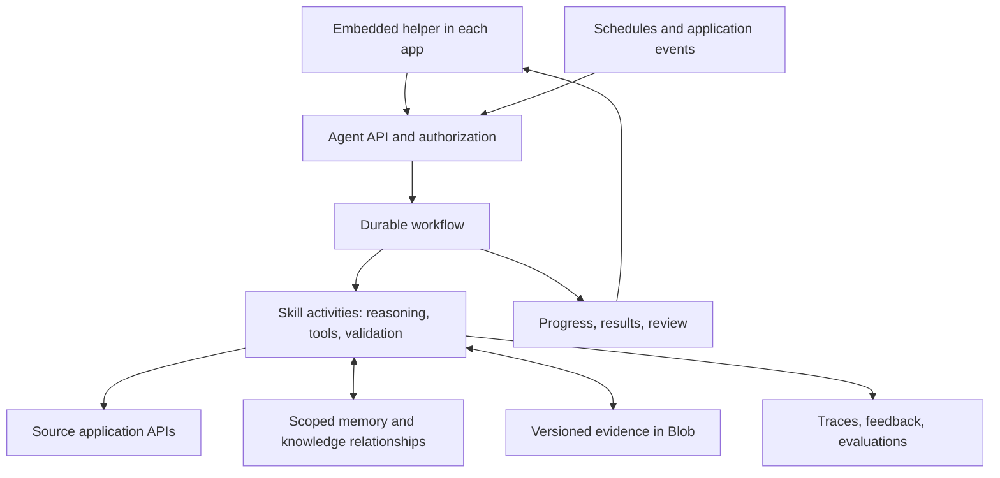

# AlamoAgent Living Build Spec

- purpose: consolidate AlamoAgent product decisions, implementation evidence, target architecture, acceptance criteria, and the next build work
- status: living build spec; current capabilities and proposed work explicitly separated
- owners: Eric Wilson (product decisions), Platform engineering (implementation and verification)
- updated: 2026-10-16
- tags: alamoagent, workflows, skills, memory, knowledge, embedding, evaluations
- labels: platform-handbook, living-spec, build-plan
- related files:
  - [Integration strategy and current agent boundary](integration-platform.md#alamoagent-first-application-spanning-slice--2026-10-16)
  - [Current product surfaces](product-surfaces.md#licensing-reports)
  - [Architecture](architecture.md)
  - [Deployment receipts](deployment-operations.md#alamoagent-name--2026-10-16)
  - [LIC 624 and Executive Director workflows](executive-director-workspace.md)
  - [Approved visual identity](material-folder-design.md#alamoagent-assistant-mark)
  - [Analyst runtime](analyst-system.md)
  - [Quality gates](testing-quality.md)

## 1. Authority and maintenance

This is the canonical build spec for AlamoAgent. Keep this file current as the
product is discussed and built; do not leave decisions solely in chat or create
a separate dated plan for each iteration. The latest explicit user instruction
takes precedence over this document.

At each relevant handoff:

1. Record new or changed requirements and superseded decisions.
2. Reconcile the capability matrix with source and test evidence.
3. Mark deployment only when a release receipt verifies it; distinguish saved,
   implemented, locally verified, and deployed work.
4. Update the next deliverable, remaining questions, and acceptance evidence.
5. Update the owning current-state docs if actual behavior changed.
6. Record the date and a concise decision/change entry below.

This maintenance happens alongside authorized AlamoAgent work. It does not
create a scheduled job, authorize a release, expand user access, or enable
notifications. Link release details from operations rather than copying image
digests into multiple competing records.

Status vocabulary:

- **Required:** an explicit product requirement or operating restriction.
- **Implemented:** present in source; deployment is a separate claim.
- **Deployed:** supported by a dated operations receipt.
- **Proposed:** the recommended build direction, still requiring implementation.
- **Deferred:** intentionally outside the active rollout or slice.
- **Open:** an unresolved decision or acceptance detail.

The architecture choices below capture the recommendation discussed with Eric.
Documenting them is not evidence that infrastructure has been provisioned.

## 2. Product contract and fixed restrictions

| ID | Requirement | Current decision |
|---|---|---|
| P01 | One general helper with application skills | AlamoAgent; Licensing is one skill. Earlier EveryAgent and OneAgent naming is superseded. Internal legacy API/file identifiers can remain stable. |
| P02 | Work first | Standing responsibilities and application events create useful work. Conversation directs, explains, or corrects that work; the user should not have to write a prompt for every routine check. |
| P03 | Quiet embedded experience | Small green original Alamo head/tree orb, immediate work and source access, drill-down, and optional conversation. No welcome hero, greeting, product heading, subtitle, tagline, or first-visit pop-up. Keep functional report titles and labels. |
| P04 | Preserve familiar UX | Reuse the existing report editor, material styling, and dormant chat where appropriate. Do not replace them with a new product-launch interface. |
| P05 | Private rollout | Agent navigation, UI, APIs, and workers remain Eric-only. Platform admin status is not an implicit agent grant. |
| P06 | Notification restriction | No emails yet. Earlier intended recipients Raj and Betty are retained as future product context, not active delivery authorization. |
| P07 | Andrew's identity | Wilson with the supplied red face logo is saved for later. Branding is presentation only; Andrew has no agent access or worker assignment enabled. |
| P08 | Cross-application ambition | The same agent should work through connected applications. Each app retains its runtime, transactions, rules, and authorization. |
| P09 | Learn within scope | Personal preferences, source-backed company knowledge, task continuity, and tested procedural improvements are distinct. |
| P10 | Traceable licensing work | Readable summaries and report text, preserved source links/originals, honest extraction/freshness states, and drill-down into evidence. |
| P11 | Native LIC 624 plus backlog intake | New forms can start in-app; uploads remain useful for backlog. Preserve the existing editor and validate fidelity to the official form. |
| P12 | Demonstrable quality | Reliability and useful outcomes are measured through acceptance tests and evals. “Perfect” is an objective, not a readiness claim. |

Raj and Betty retain standalone Licensing permissions. The previous request for
a Jarvis-like introduction was superseded by the later explicit removal of all
introductory copy. The original combined Alamo logo is the selected one; the
more prominent color variant was superseded.

## 3. Baseline and evidence

Baseline reconciled on 2026-10-16 against this checkout and the existing dated
deployment receipts. Production was not re-probed while creating this spec.

| Capability | Status | Evidence and practical limit |
|---|---|---|
| Private embedded helper and agent workspace | Deployed | [Product surfaces](product-surfaces.md#licensing-reports), [rename release](deployment-operations.md#alamoagent-name--2026-10-16). Workspace, compact companion, sources, scope, pause/resume, review receipts, history. |
| Licensing and Admissions watch skills | Deployed | [Catalog](../../shared/everyagent-catalog.mjs), [adapters](../../server/everyagent-adapters.mjs). Pipeline supplies protected aggregate summaries only. |
| Personal monitoring state | Deployed | [Service](../../server/everyagent-service.mjs), [persistence](../../server/everyagent-persistence.mjs). ETag-protected Blob, source fingerprints, lease, assignments and work history. |
| General durable workflow engine | Proposed | Existing timer/lease worker handles bounded monitoring; it is not a general persisted multistep agent runtime. |
| Dormant owner chat | Implemented, separate surface | [OwnerChatPage](../../src/features/home/pages/OwnerChatPage.tsx) reuses the existing conversational analyst workspace. The agent companion currently links to Ask a question; conversation is not integrated into its tasks. |
| Native LIC 624 creation and editing | Deployed | [Native reports](executive-director-workspace.md#native-reports), October 13 release. Create, save, reopen, review, and versioned audit are present. The earlier upload-only limitation is obsolete. |
| Upload and extraction | Implemented; see owning workflow for release evidence | Fillable-PDF extraction and review exist. Image-only files stop at OCR-required; connected OCR, automatic filing, incident linking, and official-PDF generation are not delivered by native creation. |
| Readable state-report reader | Deployed | [Licensing Reports](product-surfaces.md#licensing-reports). Briefs, paragraphs, page references, findings/corrections, and original download. |
| Andrew's Wilson branding | Implemented and verified; deferred rollout | [Brand resolver](../../shared/agent-branding.mjs), [saved identity](material-folder-design.md#andrews-saved-wilson-mark). Source commit 79efed7; not deployed by the branding request. |
| Company knowledge store | Local prototype | [Integration knowledge boundary](integration-platform.md#company-knowledge-and-workflow-boundary). Immutable documents, proposed assertions, review and search contracts; not durable production memory. |
| General graph, editable personal memory, skill authoring, learning loop | Proposed | Evidence references attached to work are not yet a shared knowledge graph or an automated improvement system. |
| Email and broader rollout | Deferred | Email delivery remains disabled; no send action in the current agent command contract. |

Current implementation specifics:

- React 19, TypeScript 5, Vite 8, Tailwind/custom CSS, MSAL/Entra.
- Node ESM API modules with checked contracts, hosted with the browser bundle in
  Azure Container Apps. Vercel adapters are retained but do not describe the
  current public production host.
- Existing Claude synthesis follows deterministic analyst tools. The actual
  configured production model is not inferred from a source default.
- Databricks/published snapshots own governed analytics; Blob holds documents,
  source captures, and current agent state.
- The web worker wakes every minute; due assignments check published sources
  every 15 minutes under a two-minute lease. State collection has its own
  Monday/Wednesday cadence. These clocks must not be conflated.
- Current state has bounded history and capacity. It is an intentional first
  slice, not the target storage architecture for all workflow executions.

## 4. Target stack and system boundaries

| Layer | Proposed choice | Keep, extend, or add |
|---|---|---|
| Embedded UI | React/TypeScript shared components and existing chat/module renderer | Extend; embed the same task surface in authorized hosts |
| API and application tools | Node/TypeScript on Azure Container Apps, Entra authentication, managed identities | Extend existing boundary |
| Durable orchestration | Azure Durable Functions with its supported TypeScript/JavaScript integration | Add a separately deployed workflow runtime; select its storage backend during the first implementation slice |
| Reasoning | Existing Claude integration behind typed model/tool contracts | Reuse initially; version model selection per skill and compare changes through evals |
| Skills | Versioned TypeScript capability packages with input/output schemas | Extend the current catalog into executable, tested contracts |
| Operational records | Azure PostgreSQL | Add transactional task projections, assignments, evidence metadata, memory, and relationship records |
| Retrieval | PostgreSQL full-text search plus pgvector when semantic retrieval is needed | Add scope-filtered, rebuildable indexes |
| Source bytes | Azure Blob | Retain immutable originals and derived artifact versions |
| App integration | Authenticated APIs and versioned events with stable identifiers | Extend per source application; source owns its transactions |
| Observability and quality | Structured traces, Azure Monitor/Application Insights, existing test scripts and task eval datasets | Add durable trace/outcome records with redacted/minimized payloads |

The orchestration backend owns execution checkpoints and replay history.
Postgres owns application-facing task metadata, authorization references,
memory, evidence relationships, and query projections. Define versioned events
and idempotent projection updates; do not create two competing execution state
machines or assume cross-service writes are atomic.

The model runtime operates inside workflow activities. Deterministic
orchestrator code does not make live model or external API calls during replay.
No agent SDK alone is assumed to provide the durable business workflow.

Azure Durable Functions currently supports TypeScript. The separate standalone
Durable Task JavaScript/TypeScript SDK is documented as preview; the proposed
production foundation uses the supported Functions integration. Recheck service
availability and package compatibility when implementing.
[Microsoft workflow documentation](https://learn.microsoft.com/en-us/azure/container-apps/workflows-overview)

Azure PostgreSQL supports pgvector for similarity search; similarity does not
establish truth or authorization.
[Microsoft pgvector documentation](https://learn.microsoft.com/en-us/azure/postgresql/extensions/how-to-use-pgvector)

Do not move Pipeline referral transactions or AlamoHealth clinical code into
Platform. A connector or host is complete only when its real contract, access
checks, failure behavior, and tests exist. A logo, app link, or catalog entry is
not an integration. Additional frameworks, message brokers, graph databases,
or model providers need a concrete requirement and evidence of benefit.

## 5. Workflow and execution contract

Every run records a task ID, tenant and owner, assignment or initiating event,
permitted application/community/record scope, workflow and skill versions,
input references, success conditions, timestamps, budgets, and outcome.

Proposed task lifecycle: queued, running, waiting for review or input, completed,
failed, or canceled. Retries are attempts within a task. A paused standing
assignment stops new scheduled work; cancellation governs an individual run.
Specify the race behavior before introducing external writes.

Required execution behavior:

- Durable timers, waits, bounded retries/backoff, cancellation, and recovery
  after deployment or worker loss.
- Stable event IDs and deduplication. Side-effecting tool calls carry operation
  keys honored by the destination, or reconcile ambiguous results before retry.
- Check authorization on each tool action, after waits, and before publication.
  Bind execution to the relevant assignment version; scope changes invalidate
  pending work that no longer qualifies.
- Persist tool/model outcomes and evidence references. Pin workflow, skill,
  prompt, and model configuration versions for an in-flight run.
- Enforce step, time, token, and cost bounds; fail or request needed input
  rather than loop indefinitely.
- Treat fetched documents and app text as evidence, never authority to change
  instructions, access, destinations, or permitted actions.
- Any future review gate records the exact proposed action and resource
  version; changed payloads or stale approvals require revalidation.
- Preserve unavailable, stale, ambiguous, and verified-zero states separately.

First complete workflow: licensing change review.

1. Resolve an authorized assignment and check the published source or invoke
   an explicitly allowed collection activity.
2. Capture the original and its URL, content hash, retrieval time, publication
   date, and report/inspection dates when present.
3. Extract readable text with page/section provenance; retain the raw original.
4. Compare versions and distinguish new reports from changed content.
5. Produce a structured brief with findings, source-supported dates,
   correction details, and clearly labeled unknowns.
6. Validate identity, scope, citations, schemas, and factual support.
7. Publish one work item per relevant change and expose the supporting original.
8. Attach questions, corrections, and review receipts to that task.

This workflow does not infer that an old correction deadline is currently
overdue. It does not send email under the current restriction.

## 6. Cross-app embedding and authorization

A proposed host context includes application ID, current route, selected
community/record references, filters, and the active task or conversation.
The server verifies each supplied reference; host context expresses intent
and never grants permission. Do not ingest arbitrary page content by default.

Effective access is the intersection of user permissions, source-app
permissions, assignment scope, skill actions, and any narrower task scope.

- The same helper can appear in multiple apps without giving those apps shared
  database access or copying their runtime code.
- Each adapter owns a bounded API/tool contract, source authentication,
  stable record IDs, freshness rules, size limits, and error mapping.
- Background jobs use explicit server-side grants and managed credentials;
  they do not store a browser access token as permanent authority.
- Revalidate grants after revocation and after long waits. Apply access filters
  before retrieval reaches the model, including graph traversal and embeddings.
- Carry explicit task/record references across hosts. Do not automatically
  merge all application transcripts or private memories into one context.
- Personal branding remains separate from grants. Wilson cannot activate
  Andrew's access. Source-app access does not itself activate the agent.
- New hosts preserve keyboard/focus behavior, responsive layout, and the
  user's task context. The current Pipeline skill is not proof of a Pipeline
  embedded host.

The companion should show actual work, progress, and evidence with optional
conversation. Reuse the dormant chat's working components after tracing their
dependencies; do not mount a second competing state or polling system.

## 7. Skills and personal responsibilities

A reusable skill definition describes how a job is performed. A personal
assignment selects which resources, triggers, preferences, and outputs apply
to a particular user. Team assignments are deferred beyond the private pilot.

Each executable skill should declare:

| Contract area | Required contents |
|---|---|
| Identity | Stable skill ID, version, owner, application/capability |
| Invocation | Supported intents, event/schedule/manual triggers, input schema |
| Scope | Required grants, eligible resources, field/data minimization rules |
| Tools | Explicit allowed operations, action categories, tool schemas |
| Procedure | Instructions, bounded planning steps, examples and recovery rules |
| Result | Output schema, artifacts, evidence/citation requirements |
| Validation | Deterministic checks, review rules, completion conditions |
| Memory | Which scoped records may be read, proposed, corrected, or persisted |
| Limits | Time, steps, tokens, cost, retry and idempotency policy |
| Quality | Fixtures, eval dataset/version, thresholds, release/rollback record |

Build a skill by choosing a real job and acceptance examples, exposing the
minimum source tools, implementing the workflow, testing failures and scope,
and then registering it. Load only permitted relevant skill instructions/tools
for the task. General user authoring can later compose approved capabilities;
new executable tools require normal code and contract review.

Candidate progression: improve Licensing change review; prove a second durable
workflow using Pipeline aggregates; later consider authorized native LIC 624
draft assistance and other app-specific work. Draft creation, edits, filing,
notifications, and clinical actions each require their own action contract and
authorized rollout; existing read skills do not confer them.

## 8. Memory, knowledge graph, and learning

| Memory kind | Examples | Scope and lifecycle |
|---|---|---|
| Task continuity | Inputs, step results, open questions, review receipts | Task and owner scope; persisted across sessions with retention rules |
| Personal preference | Summary length, preferred ordering, assigned communities | User-visible, editable/deletable; does not override app policy |
| Company knowledge | Source-backed report/finding/facility relationships | Explicit sharing scope, provenance, timestamps, validity, review state |
| Procedural improvement | A better extraction rule or skill prompt | Versioned candidate, tested before release; separate from live memory |

Notification restrictions and authorization are enforced policy/configuration,
not soft conversation memory. Normal use does not silently retrain model weights.

Start the graph with relational nodes and edges such as community → report →
finding → follow-up task → responsible person. Preserve canonical source IDs,
source document/version references, observation and applicable dates, access
scope, assertion status, and supersession/correction links. Model-extracted
assertions enter proposed state; only the explicit review path promotes them
to approved knowledge. Review of a work card is not approval of every assertion.

Search is a rebuildable projection. Source records remain authoritative.
Define stale-evidence handling, conflict resolution, expiry, deletion, and
permission revocation for both source records and derived indexes. Removing a
personal memory must stop its future retrieval; audit retention requirements
must be specified separately and visible.

Proposed improvement loop:

1. Capture observable calls, versions, evidence references, outcome, latency,
   cost, and user correction with minimal sensitive payloads.
2. Triage the correction into preference, knowledge correction, or skill defect.
3. Convert confirmed defects into reproducible eval cases; keep held-out cases.
4. Propose a changed prompt, tool, parser, routing rule, or model configuration.
5. Run deterministic checks, task evals, and human review on important samples.
6. Compare the candidate in a read-only shadow run, then a limited release.
7. Promote a version only with recorded results; retain rollback.

Do not log hidden model reasoning or let a runtime agent rewrite its own
production authorization or executable tools. Fine-tuning is a future option
only if measured failures justify it.
[Agent evaluations](https://developers.openai.com/api/docs/guides/agent-evals)
and [reviewed improvement loop](https://developers.openai.com/cookbook/examples/agents_sdk/agent_improvement_loop)
inform this proposed process.

## 9. Acceptance and evaluation gates

Every build slice includes quality work. Advanced learning may arrive later;
permission, recovery, and result checks begin with the first workflow.

| ID | Acceptance requirement | Evidence required |
|---|---|---|
| Q01 | Resume interrupted work | Kill/restart a worker between meaningful steps; same task resumes with correct prior results |
| Q02 | Deduplicate delivery and actions | Repeated event and ambiguous-response tests produce one intended result; side effects are destination-idempotent or reconciled |
| Q03 | Enforce isolation and revocation | Tenant/user/community/record denial tests; revoke during execution/wait; deny subsequent reads/actions/publication |
| Q04 | Ground claims | Representative reports with claim-to-source checks; distinguish source facts, inference, dates, unknowns, and mixed findings |
| Q05 | Preserve source truth | Missing/stale/failed/zero cases remain distinguishable and retain prior evidence |
| Q06 | Preserve user control | Pause, cancel, review, correct, retry and memory-edit flows; inspect real task progress |
| Q07 | Keep the helper usable | Phone/desktop, keyboard, focus, retained scope, readable reports, source links, no introductory launch copy |
| Q08 | Prevent instruction injection | Untrusted report/tool text cannot change grants, tools, destinations, or workflow restrictions |
| Q09 | Bound resources | Measured step, latency and cost budgets, timeouts and failure outcomes; numerical targets fixed before release |
| Q10 | Release repeatably | Versioned workflow/skill/model/config, regression results, migration checks, and rollback evidence |
| Q11 | Respect rollout restrictions | Eric-only agent; Raj/Betty standalone Licensing; Andrew inactive; no email delivery |
| Q12 | Retain form fidelity | Preserve native editor/review behavior; official-form field/content comparison and representative demo validation before claiming official output parity |

Use deterministic assertions for permissions, schemas, replay, and duplicate
prevention. Use fixed representative task datasets, semantic grading, and human
review for factual completeness and usefulness. Automated model graders do not
prove security or correctness. Include both unchanged and changed sources,
different document formats, extraction failures, wrong-community records,
permission changes, and adversarial text.

Existing checks remain the regression base: check:everyagent, check:licensing,
check:licensing-job, check:platform-knowledge, and relevant browser/form checks.
The owning app's docs, TypeScript, full analyst, and build gates remain required.
No new workflow is considered complete from a mock-only UI or a passing build.

Spec consolidation verification, 2026-10-16: documentation/link and repository
retention checks, both TypeScript checks through the full analyst gate, the
complete analyst suite, and the production build passed. This verifies the
documentation change against the existing code; it does not establish the
proposed workflow or memory capabilities. No production release was performed.

## 10. Build sequence and active deliverable

| Slice | Deliverable | Exit evidence | Status |
|---|---|---|---|
| S0 | Reconciled living spec and agent entry-point guidance | Current/planned split, requirement IDs, implementation map, linked handbook and retention registration | Implemented in this documentation change |
| S1 | Durable task foundation exercised by a Licensing check | Scoped contracts, persisted checkpoints, execution/DB ownership, restart, duplicate, cancellation and revocation tests; traceable result | Proposed; next build slice |
| S2 | Complete Licensing workflow with task-linked conversation | Captured source → validated brief → work item → correction; existing chat reused; mobile and keyboard review | Proposed |
| S3 | Second durable workflow and second embedded host | Pipeline adapter permissions and aggregate boundary preserved; same task accessible from authorized hosts; no transcript leakage | Proposed |
| S4 | User-controlled memory and knowledge relationships | Memory review/edit/delete, source-backed graph, scoped retrieval, assertion approval and correction tests | Proposed |
| S5 | Measured improvement and additional skills | Corrections become evals, candidate comparisons, version promotion/rollback, task-level cost/latency targets | Proposed |
| S6 | Broader rollout and optional notifications | Explicit rollout decision and per-user/action validation; recipients/channels confirmed at that time | Deferred |

S1 should be a vertical implementation: one real Licensing check uses the new
foundation. Avoid generic unused infrastructure. Preserve the current worker
and state until migration/recovery is verified.

Migration must account for existing assignments, scope, review receipts, and
unresolved work. Plan an idempotent import from the existing Blob, compare
results, prevent both schedulers from publishing concurrently, and define how
rollback preserves writes after cutover. A database or workflow deployment by
itself is not completion.

The next concrete proof is: a Licensing task survives a restart, produces one
cited result, accepts a correction, and passes the regression case derived from
that correction. Deliver this through S1/S2 while maintaining the private pilot.

## 11. Open decisions and deferred work

- Select Durable Functions storage/hosting details, regional availability,
  Node/package versions, infrastructure ownership, and operating cost for S1.
- Specify database schema, migrations, connection/identity model, backup and
  restore, task projection consistency, and retention/deletion policy.
- Define per-skill quality, latency and cost thresholds using baseline cases;
  do not invent pass rates before measuring representative tasks.
- Define the host context/conversation contract and which existing chat
  components can be extracted without disturbing analyst behavior.
- Inventory additional applications, API owners, event contracts, and shared
  identifiers. AlamoHealth capabilities remain a separate future integration.
- Reconcile LIC 624 against the exact official form supplied by Eric; native
  entry exists, but official-PDF export and proven layout parity remain separate.
- OCR for scanned backlog, incident linking, automatic filing, and mail intake
  remain governed by the owning Licensing/Executive Director spec.
- Email recipients Raj and Betty are historical intent only until delivery is
  explicitly re-enabled. Andrew's Wilson rollout remains deferred.
- No separate vector service, dedicated graph database, multi-agent topology,
  or fine-tuning project is required to start the first durable workflow.

## 12. Decision and change record

| Date | Decision or correction | Consequence |
|---|---|---|
| 2026-10-16, consolidated from conversation and source | General helper across applications with Licensing as a skill | Keep one agent identity and explicit per-app capabilities |
| 2026-10-16 | AlamoAgent is the current name; original combined mark selected | Earlier names/alternate color variant are superseded |
| 2026-10-16 | Remove introductory UI; retain familiar editor and dormant chat assets | Work and evidence lead; conversation is integrated progressively |
| 2026-10-16 | Eric-only rollout, emails disabled | Apply restrictions across UI, API, worker, and future workflows |
| 2026-10-16 | Save Andrew's Wilson branding for later | Presentation implementation does not grant or deploy access |
| 2026-10-16, reconciliation | Native LIC 624 was deployed October 13 | Do not repeat the earlier claim that uploads are required to create a report |
| 2026-10-16 | Proposed TypeScript/Azure durable workflow, Postgres memory, versioned skills, and eval-driven improvement | Record as target architecture; no provisioning or deployment claimed |
| 2026-10-16 | Eric requested continuous build-spec maintenance | Link this spec from AGENTS and handbook; update decisions, status, evidence, and next work with each relevant change |
